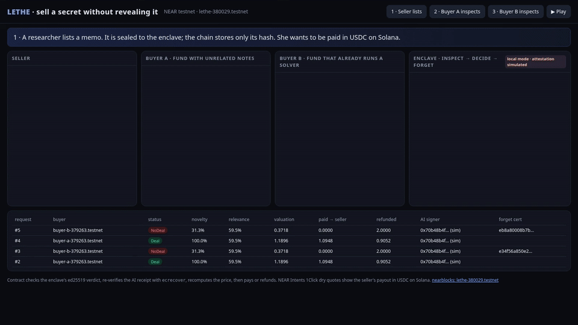

# LETHE: an information market where the AI forgets

**Sell a secret without revealing it. Buyers pay only for what they don't already know.**

In 1962 Kenneth Arrow pointed out that information is hard to sell: to know what it's worth you have to see it, and once you've seen it you don't need to pay. Expert networks, alternative-data vendors and research desks work around this with NDAs, previews and trust.

LETHE works around it with an enclave and a NEAR contract:

1. A **seller** lists a memo sealed to the enclave's key. The chain stores only its sha256 and the ciphertext.
2. A **buyer** escrows a budget and seals **its own private notes** to the same enclave.
3. `inspect` opens a **NEAR yield**, so the buyer's transaction waits. Inside the enclave:
   - every claim in the memo is compared with the buyer's notes (deterministic embeddings, so **novelty is relative to this buyer**);
   - a model scores relevance and returns a **signed receipt**.
4. The enclave answers with an ed25519-signed verdict. The **contract** then:
   - checks that signature;
   - re-verifies the AI receipt with `ecrecover`;
   - reads the score out of the signed response body;
   - **recomputes the price itself**.

   After that it does one of two things:
   - **Deal:** the seller is paid, the buyer gets the rest of its budget back, and the memo is released sealed to the buyer's key.
   - **No deal:** the buyer gets a full refund, and the enclave zeroizes the memo and the buyer's notes and signs a **forget certificate** that is stored on-chain.
5. The seller's payout chain is their choice. The demo derives the seller's **Solana address from its NEAR account via Chain Signatures** and quotes the route to USDC on Solana through **NEAR Intents 1Click** (dry quote).

Two funds inspect the same memo with the same budget. Fund A knows nothing about the topic, so the memo is new to it and it buys. Fund B already runs a solver and knows most of the memo, so it gets no deal, a refund, and a forget certificate.



60-second video: [docs/lethe-demo.mp4](docs/lethe-demo.mp4) (recorded live against `lethe-380029.testnet`).

> Built for NEAR HACKATHON (Nov 2026). **Other project by the same author:** [ChainProof Guard](https://github.com/jayanth-kumar-morem/chainproof-guard), an on-chain spending firewall for AI agents. The two projects are independent: separate repositories, contracts, accounts and code (rule Q-015).

---

## Try it

### 1. Tests (no keys, no accounts)
```sh
make test
```
Expected output:
- `contract` unit tests: 2 passed.
- `tests/sandbox.rs`: 1 passed. It runs a local NEAR sandbox and covers:
  - the yield/resume round trip;
  - on-chain `ecrecover` of a NEAR-AI-style receipt;
  - rejection of a tampered response body, an unregistered AI signer, a forged enclave signature, a replayed receipt, and a budget below the ask;
  - a deal (10 NEAR budget, novelty 0.9, relevance 0.8, so valuation 7.2, payment `4 + (7.2−4)/2 = 5.6`, refund 4.4);
  - a no-deal with a full refund and the forget-certificate hash;
  - a timeout with a refund.
- `enclave` (node --test): 6 passed. Covers:
  - sealed-box isolation;
  - verdict signatures;
  - buyer-relative novelty (A ≥ 90%, B ≤ 45%);
  - padding or injection in the memo doesn't move novelty;
  - simulated receipts have NEAR AI's exact shape.

### 2. Audit the live testnet deployment (no keys)
```sh
make verify            # LETHE_CONTRACT=lethe-380029.testnet by default
```
Expected: one `OK` line per settlement, alternating like this:
```
#0 Deal    novelty 100.0% relevance 59.5% [simulated AI signer] OK
#1 NoDeal  novelty 31.3% relevance 59.5% [simulated AI signer] OK
```
For every settlement, `verify.js` re-checks from public RPC data:
- the AI receipt recovers to a registered signer;
- the simulated flag matches the registry;
- `valuation = budget × novelty × relevance`;
- `paid + refunded = budget`;
- the forget-certificate hash.

Contract: <https://testnet.nearblocks.io/address/lethe-380029.testnet>

### 3. Run the whole flow on your own testnet deployment
```sh
near account create-account sponsor-by-faucet-service <you>.testnet autogenerate-new-keypair save-to-legacy-keychain network-config testnet create
near account create-account sponsor-by-faucet-service <buyer-a>.testnet autogenerate-new-keypair save-to-legacy-keychain network-config testnet create
near account create-account sponsor-by-faucet-service <buyer-b>.testnet autogenerate-new-keypair save-to-legacy-keychain network-config testnet create
OWNER=<you>.testnet make deploy
BUYER_A=<buyer-a>.testnet BUYER_B=<buyer-b>.testnet make demo
```
You should see:
- `listed #0` with a Solana payout address derived by Chain Signatures.
- Buyer A: `settled: Deal · novelty 100.0%`, `delivery decrypted … sha256 matches listing: true`, and a NEAR Intents dry quote in USDC on Solana.
- Buyer B: `settled: NoDeal · novelty ~31%`, `refunded 2.0000 NEAR`, and the forget certificate.

`make console` (with `BUYER_A`/`BUYER_B` set) opens the same flow as a web console at `http://localhost:8787`. Press ▶ Play.

Optional: set `NEARAI_API_KEY` (from cloud.near.ai) before `make demo` to switch relevance scoring from the local stand-in to a TEE-hosted model on NEAR AI Cloud. See the table below.

---

## What is real and what is simulated

| Piece | Status in this repo |
|---|---|
| NEAR contract on testnet: listings, escrow, yield/resume, settlement, refunds, timeout | **Real**, deployed at `lethe-380029.testnet` |
| On-chain ed25519 check of the enclave verdict | **Real** |
| On-chain `ecrecover` of the AI receipt, body-hash binding, score parsed from the signed body, replay protection | **Real** (exercised with the stand-in signer on testnet; tamper cases in the sandbox test) |
| Price rule enforced by the contract (the model can only lower a price) | **Real** |
| Buyer-relative novelty (MiniLM embeddings, run locally) | **Real** |
| Sealed boxes (X25519) for memo, notes and delivery | **Real** |
| Seller's Solana payout address derived via **Chain Signatures** (`v1.signer-prod.testnet`, EdDSA domain) | **Real** (address derivation; no Solana transaction is signed) |
| NEAR Intents 1Click route quote NEAR → USDC on Solana | **Real mainnet quote with `dry: true`**: no deposit, nothing executes. On testnet the seller is paid in NEAR. |
| NEAR AI Cloud signer registration | **Real**: signing addresses come from NEAR AI's public attestation report, after the TDX quote and NVIDIA GPU attestation are verified off-chain with [nearai-cloud-verifier](https://github.com/nearai/nearai-cloud-verifier) (`model_verifier.py --model Qwen/Qwen3.8-27B`). |
| Relevance score from NEAR AI Cloud | **Wired, needs `NEARAI_API_KEY`**. Without a key, a local stand-in produces the identical receipt format with its own secp256k1 key. That key is registered on-chain with `simulated: true`, and every settlement records `ai_simulated`. |
| Enclave attestation | **Simulated.** The service runs in local mode on an ordinary machine. The contract trusts the ed25519 key and codehash that the owner registered. The production path runs the same service as a Shade Agent / dstack TDX container whose measurement is attested before registration. |

## Mechanism

- `valuation = budget × novelty × relevance`. The contract recomputes this from the signed inputs, using integer math with basis points.
- Deal if `valuation ≥ ask`. The seller is paid `ask + (valuation − ask)/2`, which splits the surplus (symmetric Nash bargaining over `[ask, valuation]`). The buyer is refunded the rest.
- Novelty is computed per claim. Each claim's novelty is `clamp((0.78 − maxSim)/(0.78 − 0.45))` against the buyer's sentences, and claims are weighted by their similarity to the buyer's stated need. Padding a memo with fresh but irrelevant sentences therefore barely moves the score (there is a test for this).
- The model output only feeds `relevance ∈ [0,1]`, so it can lower the price but never raise it above the budget.
- If the enclave doesn't answer within the yield window (~200 blocks), `on_verdict` runs with a timeout and refunds the buyer.
- Yield payloads are capped at 1 KiB on testnet. `respond` therefore stores the checked settlement in state, and the resume carries only a signal.

## Threat model

- **Trusted:** the enclave's confidentiality and integrity; the owner's off-chain verification of the enclave and AI signer attestations; the NEAR AI Cloud TEE when it is used.
- **Not trusted:**
  - **The seller**, who may try to inject into the scorer. Novelty involves no LLM. Relevance is a clamped number read from a signed body, and the contract applies it.
  - **The buyer**, who may try to see the memo without paying. It only ever receives `{novelty, relevance}` before paying: two numbers, which is the price of inspection, and they leak little.
  - **The relayer**, which only carries signed verdicts.
  - **The operator and host**, which see ciphertext only, assuming the enclave holds.
- **"Forgetting" is attested, not proven.** It is only as credible as the enclave. Local mode gives no guarantee, which is why it is labeled simulated.
- **Physical TEE attacks** (e.g. TEE.fail, Oct 2025) can extract attestation keys. Mitigations to add:
  - cap value per listing and per enclave key;
  - add a challenge window before payout;
  - rotate keys (`set_enclave`).
- **NEAR AI Cloud signing keys rotate** when the backend restarts. The owner re-registers them from the public attestation report (`add_ai_signer`), and the deploy script does this.
- **Ciphertexts are on-chain.** If the enclave's X25519 key ever leaks, past listings and notes leak too. Production should rotate keys per epoch and store blobs off-chain with on-chain commitments.
- **The request hash in a NEAR AI receipt** binds the prompt, but the contract cannot see the prompt, which contains the secret. The binding between a receipt and a request comes from the enclave's signature.

## Research lineage and closest work

- **NDAI Agreements** (Stephenson, Miller et al., [arXiv 2502.07924](https://arxiv.org/abs/2502.07924)): TEE + AI agents as an "ironclad NDA" for Arrow's paradox.
- **Conditional Recall** ([arXiv 2510.21904](https://arxiv.org/abs/2510.21904)): credible forgetting as a mechanism-design tool.
- **Information Bazaar** ([arXiv 2403.14443](https://arxiv.org/abs/2403.14443)) and **Recursive Information Markets** ([arXiv 2604.08606](https://arxiv.org/abs/2604.08606)). The latter notes that inspection ignores what the buyer already knows, which is the gap LETHE prices.
- **Prototypes in the same category:** [NDAI/TrustKit](https://github.com/discordwell/ndai-hackathon), [TBVH](https://github.com/deepsp94/tbvh) and [DealProof](https://github.com/kkoci/Dealproof) (TEE negotiation, mostly on Base Sepolia). LETHE differs in three ways:
  - price is set by **novelty against the buyer's own sealed notes**;
  - an explicit **forget certificate** is recorded on-chain;
  - money rules are enforced **by the contract, from signed inputs**, with NEAR-native settlement (yield/resume, Chain Signatures, Intents).

## Layout

```
contract/            Rust (near-sdk 5.30): lib.rs, tests/sandbox.rs
enclave/service.js   enclave loop (local mode): decrypt → novelty → relevance+receipt → verdict → respond
enclave/lib/         keys (libsodium), novelty (transformers.js MiniLM), ai (NEAR AI Cloud / stand-in), near, intents
enclave/cli.js       seller/buyer CLI · enclave/verify.js read-only audit
web/                 local web console (server.js + index.html)
scripts/             deploy-testnet.sh, demo.sh
demo/                fictional memo and two buyers' notes
```

## Hackathon compliance

- **Built in the window:** all code was written 2026-11-11 to 11-14, inside the NEAR HACKATHON window (Q-001). There is no pre-hackathon code.
- **Network use:** testnet only (Q-010). NEAR Intents is used as a mainnet `dry: true` quote only, with no deposit (Q-007). No mainnet transactions.
- **Libraries (Q-005):**
  - near-sdk, near-workspaces, near-api-js
  - libsodium-wrappers, ethers
  - @huggingface/transformers (Xenova/all-MiniLM-L6-v2)
  - ed25519-dalek, k256, sha2, sha3 (tests)
- **AI assistance (Q-005):** AI coding assistants helped write this code.
- **License:** MIT (Q-014).
